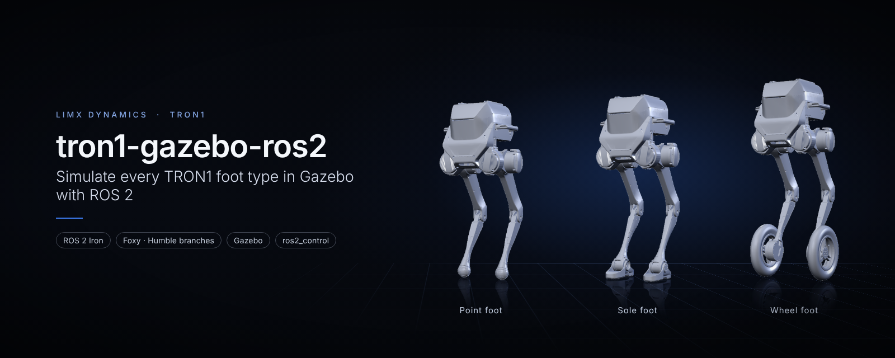
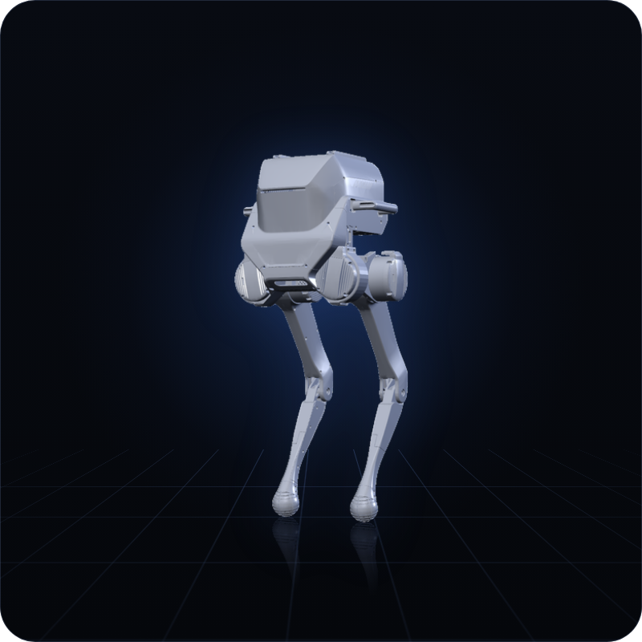
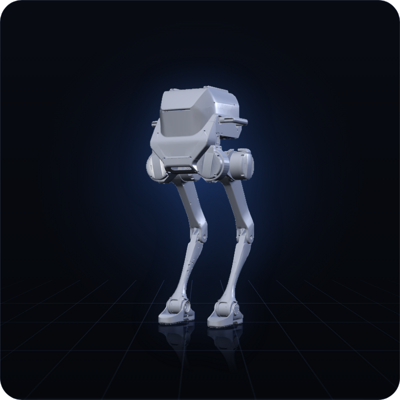
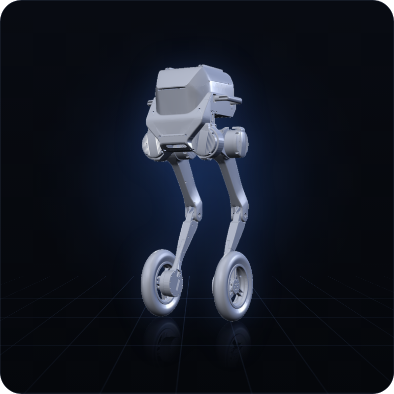
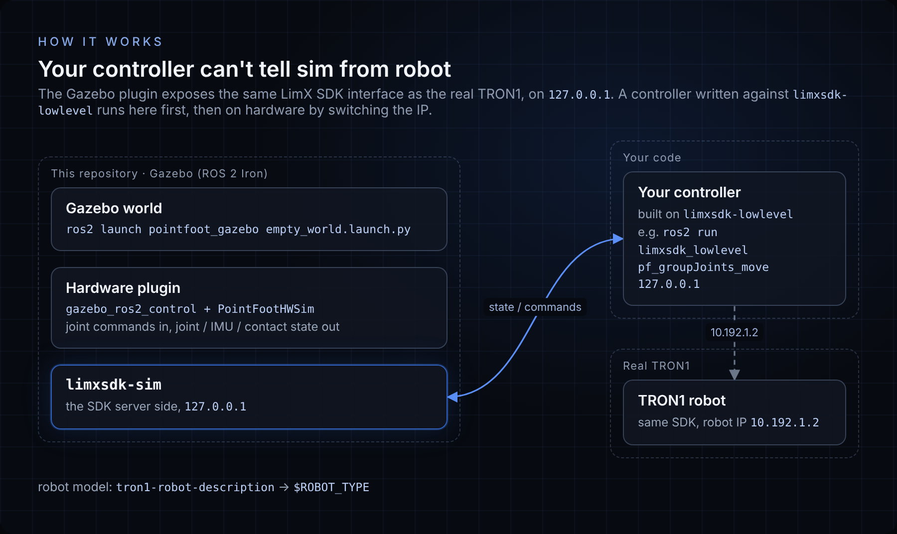

<p align="center">
  
</p>

<p align="center">
  <b>English</b> | <a href="README_cn.md">中文</a>
</p>

<p align="center">
  <a href="LICENSE"></a>
  
  
  
  <a href="https://github.com/limxdynamics/limxdynamics/blob/main/doc/wechat_qr.png"></a>
</p>
<p align="center"><sub>For partnership and procurement inquiries, contact <a href="mailto:opensource@limxdynamics.com">opensource@limxdynamics.com</a></sub></p>

# tron1-gazebo-ros2

> **Part of the TRON1 open-source ecosystem.** Where to start and the other TRON1 repositories: [TRON1 quick start](https://github.com/limxdynamics/limxdynamics/blob/main/doc/quickstart.md#tron1).

**Gazebo simulation of the LimX TRON1 biped for ROS 2.** Develop and test a TRON1 controller on your desktop, then run the same code on the real robot.

## Highlights

- **Sim and robot share one interface.** The `gazebo_ros2_control` plugin serves the same LimX SDK API as the real TRON1 on `127.0.0.1`, so a controller built on [`limxsdk-lowlevel`](https://github.com/limxdynamics/limxsdk-lowlevel) moves to hardware by changing the IP.
- **Every TRON1 foot type.** Point-foot, sole-foot and wheel-foot models load from [`tron1-robot-description`](https://github.com/limxdynamics/tron1-robot-description); pick one with `ROBOT_TYPE`.
- **The signals a controller needs.** The plugin reports joint state and IMU through `ros2_control`, updated at 500 Hz (`config/pointfoot_gazebo.yaml`).
- **Three ROS 2 distributions.** `main` targets Iron on Ubuntu 22.04; the [`feature/humble`](https://github.com/limxdynamics/tron1-gazebo-ros2/tree/feature/humble) and [`feature/foxy`](https://github.com/limxdynamics/tron1-gazebo-ros2/tree/feature/foxy) branches cover Humble and Foxy.
- **Prebuilt SDK.** `limxsdk-sim` ships libraries for amd64, aarch64, arm32 and Windows; nothing to compile on the SDK side.

## Robot models

| | Model | Description | Actuated DoF | `ROBOT_TYPE` |
| :-: | --- | --- | :-: | --- |
|  | **Point foot** | Biped with ball feet: abduction, hip and knee per leg | 6 | `PF_TRON1A` `PF_TRON1B` `PF_P441A` `PF_P441B` `PF_P441C` `PF_P441C2` |
|  | **Sole foot** | Adds an ankle joint and flat feet | 8 | `SF_TRON1A` `SF_TRON1B` |
|  | **Wheel foot** | Driven wheels in place of feet | 8 | `WF_TRON1A` `WF_TRON1B` |

Models and DoF come from `tron1-robot-description`; images are rendered from its MuJoCo models with the same camera and lighting.

## How it works

<p align="center">
  
</p>

## Set up and run

### 1. Set up the Development Environment

Install ROS 2 Iron: Set up a ROS 2 Iron-based algorithm Development Environment on the Ubuntu 22.04 operating system. For installation, please refer to the documentation: https://docs.ros.org/en/iron/Installation/Ubuntu-Install-Debians.html, and choose "ros-iron-desktop" for installation. After the installation of ROS 2 Iron is completed, enter the following Shell commands in the Bash end point to install the libraries required by the Development Environment:

```bash
sudo apt update
sudo apt install ros-iron-urdf \
             ros-iron-urdfdom \
             ros-iron-urdfdom-headers \
             ros-iron-kdl-parser \
             ros-iron-hardware-interface \
             ros-iron-controller-manager \
             ros-iron-controller-interface \
             ros-iron-controller-manager-msgs \
             ros-iron-control-msgs \
             ros-iron-controller-interface \
             ros-iron-gazebo-* \
             ros-iron-rviz* \
             ros-iron-rqt-gui \
             ros-iron-rqt-robot-steering \
             ros-iron-plotjuggler* \
             ros-iron-control-toolbox \
             ros-iron-ros2-control \
             ros-iron-ros2-controllers \
             ros-dev-tools \
             cmake build-essential libpcl-dev libeigen3-dev libopencv-dev libmatio-dev \
             python3-pip libboost-all-dev libtbb-dev liburdfdom-dev liborocos-kdl-dev -y
```

### 2. Create Workspace

You can create an algorithm development workspace by following these steps:
- Open a Bash end point.
- Create a new directory to store the workspace. For example, you can create a directory named "limx_ws" under the user's home directory:

  ```bash
  mkdir -p ~/limx_ws/src
  ```

- Download the robot model description file

  ```bash
  cd ~/limx_ws/src
  git clone https://github.com/limxdynamics/tron1-robot-description.git robot-description
  ```

- Download the Motion Control Development Interface:

  ```bash
  cd ~/limx_ws/src
  git clone https://github.com/limxdynamics/limxsdk-lowlevel.git
  ```

- Download Visualization Tool

  ```bash
  cd ~/limx_ws/src
  git clone https://github.com/limxdynamics/robot-visualization.git
  ```

- Download Gazebo Simulator:

  ```bash
  cd ~/limx_ws/src
  git clone https://github.com/limxdynamics/tron1-gazebo-ros2.git
  ```

- Compile Project:

  ```bash
  cd ~/limx_ws
  source /opt/ros/iron/setup.bash
  colcon build --cmake-args -DCMAKE_BUILD_TYPE=Release
  ```

- Select robot type
  - List available robot types via the Shell command `tree -L 1 src/robot-description/pointfoot`:

    ```
    src/robot-description/pointfoot
    ├── PF_P441A
    ├── PF_P441B
    ├── PF_P441C
    ├── PF_P441C2
    ├── PF_TRON1A
    ├── PF_TRON1B
    ├── SF_TRON1A
    ├── SF_TRON1B
    ├── WF_TRON1A
    └── WF_TRON1B
    ```

  - Taking `PF_P441C` (please replace it according to the actual robot type) as an example, set the robot model type:

    ```bash
    echo 'export ROBOT_TYPE=PF_P441C' >> ~/.bashrc && source ~/.bashrc
    ```

- Run the simulation: You can set the `use_support` parameter in `empty_world.launch.py` to `true` (this hangs the robot base 0.3 m above the ground, useful for debugging joints in the air), and execute the following Shell command to run the simulation:

  ```bash
  source /opt/ros/iron/setup.bash
  source install/setup.bash
  ros2 launch pointfoot_gazebo empty_world.launch.py
  ```

- Run the control routine to ensure that the robot in the simulator is moving, indicating that the simulation environment has been successfully set up:

  ```bash
  source /opt/ros/iron/setup.bash
  source install/setup.bash
  ros2 run limxsdk_lowlevel pf_groupJoints_move 127.0.0.1
  ```

  

## Next steps

- Run a trained RL walking policy in this simulator: [`tron1-rl-deploy-ros2`](https://github.com/limxdynamics/tron1-rl-deploy-ros2).
- Using ROS 1 Noetic instead: [`tron1-gazebo-ros`](https://github.com/limxdynamics/tron1-gazebo-ros).

## License

See [LICENSE](LICENSE).
