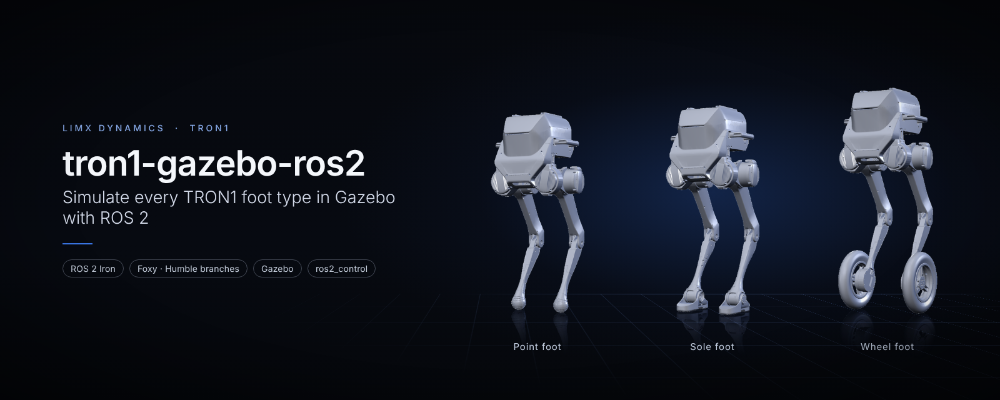
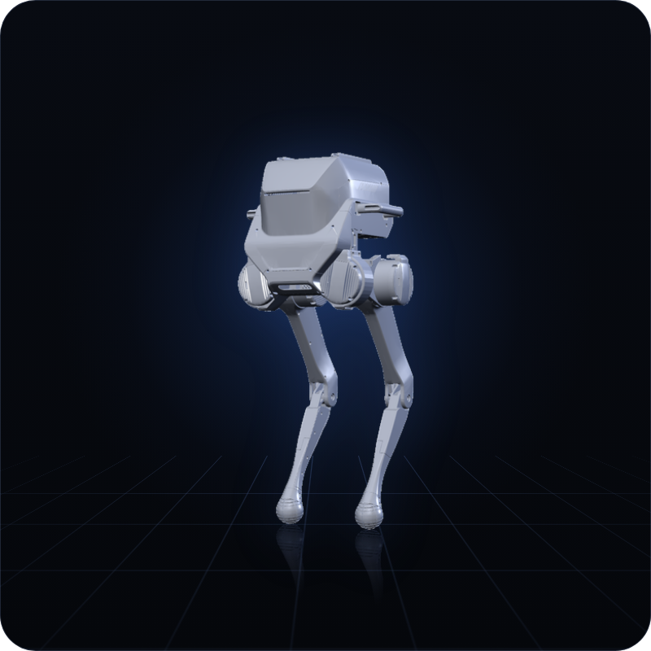
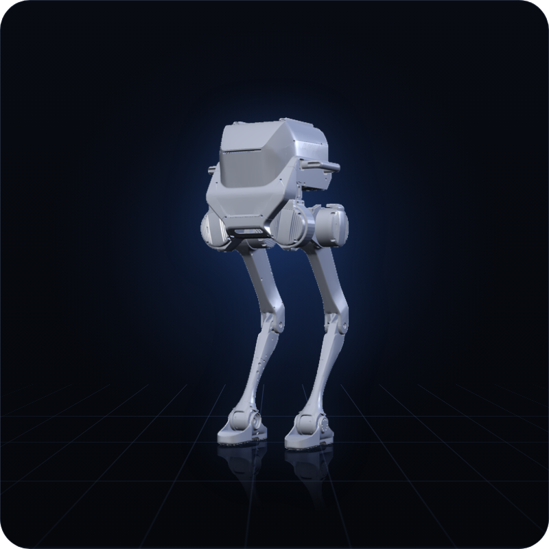
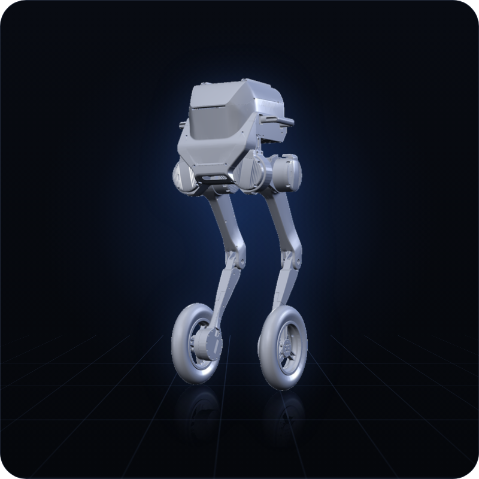
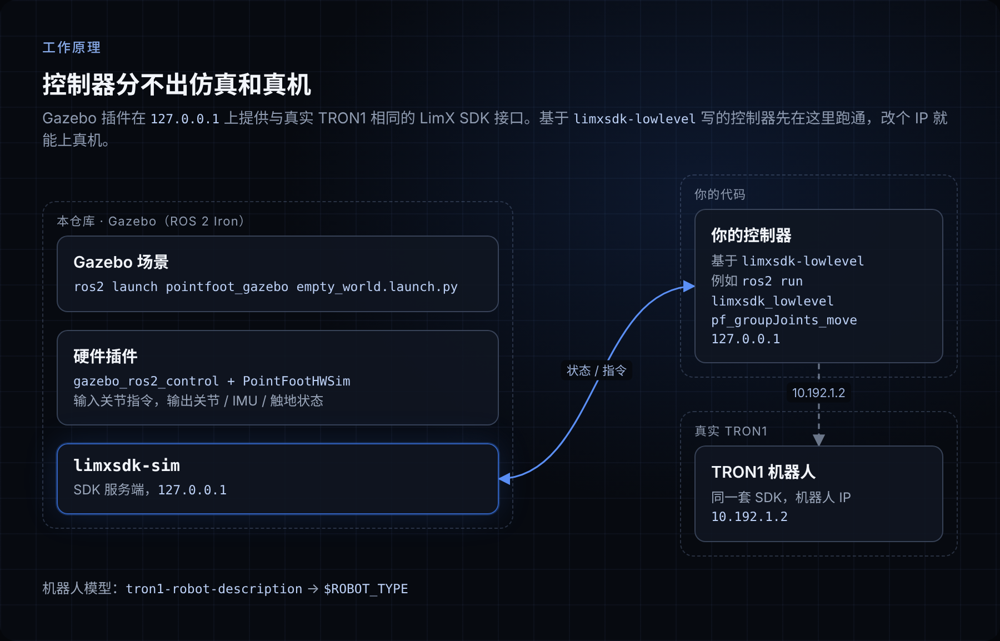

<p align="center">
  
</p>

<p align="center">
  <a href="README.md">English</a> | <b>中文</b>
</p>

<p align="center">
  <a href="LICENSE"></a>
  
  
  
  <a href="https://github.com/limxdynamics/limxdynamics/blob/main/doc/wechat_qr.png"></a>
</p>
<p align="center"><sub>合作采购请联系 <a href="mailto:opensource@limxdynamics.com">opensource@limxdynamics.com</a></sub></p>

# tron1-gazebo-ros2

> **TRON1 开源生态的一部分。** 上手路线和其他 TRON1 仓库：[TRON1 快速上手](https://github.com/limxdynamics/limxdynamics/blob/main/doc/quickstart_cn.md#tron1)。

**面向 ROS 2 的 LimX TRON1 双足机器人 Gazebo 仿真。** 在电脑上开发和测试 TRON1 控制器，同一份代码再直接跑到真机上。

## 亮点

- **仿真与真机同一套接口。** `gazebo_ros2_control` 插件在 `127.0.0.1` 上提供与真实 TRON1 相同的 LimX SDK 接口，基于 [`limxsdk-lowlevel`](https://github.com/limxdynamics/limxsdk-lowlevel) 写的控制器改个 IP 就能上真机。
- **覆盖 TRON1 全部足型。** 点足、双足（带踝）、轮足模型均来自 [`tron1-robot-description`](https://github.com/limxdynamics/tron1-robot-description)，用 `ROBOT_TYPE` 选择。
- **控制器需要的信号都有。** 插件通过 `ros2_control` 输出关节状态和 IMU，更新频率 500 Hz（`config/pointfoot_gazebo.yaml`）。
- **支持三个 ROS 2 发行版。** `main` 分支对应 Ubuntu 22.04 上的 Iron；[`feature/humble`](https://github.com/limxdynamics/tron1-gazebo-ros2/tree/feature/humble) 与 [`feature/foxy`](https://github.com/limxdynamics/tron1-gazebo-ros2/tree/feature/foxy) 分支分别对应 Humble 和 Foxy。
- **SDK 预编译。** `limxsdk-sim` 自带 amd64、aarch64、arm32 和 Windows 的库，SDK 部分无需编译。

## 机器人型号

| | 型号 | 说明 | 驱动自由度 | `ROBOT_TYPE` |
| :-: | --- | --- | :-: | --- |
|  | **点足** | 球形足端，每条腿外展、髋、膝三个关节 | 6 | `PF_TRON1A` `PF_TRON1B` `PF_P441A` `PF_P441B` `PF_P441C` `PF_P441C2` |
|  | **双足（Sole）** | 增加踝关节和平底足 | 8 | `SF_TRON1A` `SF_TRON1B` |
|  | **轮足** | 以驱动轮代替足端 | 8 | `WF_TRON1A` `WF_TRON1B` |

型号与自由度来自 `tron1-robot-description`；图片由其 MuJoCo 模型以同一相机和灯光渲染。

## 工作原理

<p align="center">
  
</p>

## 安装与运行

### 1. 搭建开发环境

安装 ROS 2 Iron：在 Ubuntu 22.04 操作系统上建立基于 ROS 2 Iron 的算法开发环境。 安装请参考文档： https://docs.ros.org/en/iron/Installation/Ubuntu-Install-Debians.html ，选择“ros-iron-desktop”进行安装。ROS 2 Iron 安装完成后，Bash 终端输入以下 Shell 命令，安装开发环境所依赖的库：

```bash
sudo apt update
sudo apt install ros-iron-urdf \
             ros-iron-urdfdom \
             ros-iron-urdfdom-headers \
             ros-iron-kdl-parser \
             ros-iron-hardware-interface \
             ros-iron-controller-manager \
             ros-iron-controller-interface \
             ros-iron-controller-manager-msgs \
             ros-iron-control-msgs \
             ros-iron-controller-interface \
             ros-iron-gazebo-* \
             ros-iron-rviz* \
             ros-iron-rqt-gui \
             ros-iron-rqt-robot-steering \
             ros-iron-plotjuggler* \
             ros-iron-control-toolbox \
             ros-iron-ros2-control \
             ros-iron-ros2-controllers \
             ros-dev-tools \
             cmake build-essential libpcl-dev libeigen3-dev libopencv-dev libmatio-dev \
             python3-pip libboost-all-dev libtbb-dev liburdfdom-dev liborocos-kdl-dev -y
```

### 2. 创建工作空间

可以按照以下步骤，创建一个算法开发工作空间：

- 打开一个 Bash 终端。

- 创建一个新目录来存放工作空间。例如，可以在用户的主目录下创建一个名为“limx_ws”的目录：

  ```bash
  mkdir -p ~/limx_ws/src
  ```

- 下载机器人模型描述文件

  ```bash
  cd ~/limx_ws/src
  git clone https://github.com/limxdynamics/tron1-robot-description.git robot-description
  ```

- 下载运动控制开发接口：

  ```bash
  cd ~/limx_ws/src
  git clone https://github.com/limxdynamics/limxsdk-lowlevel.git
  ```

- 下载可视化工具

  ```bash
  cd ~/limx_ws/src
  git clone https://github.com/limxdynamics/robot-visualization.git
  ```

- 下载 Gazebo 仿真器：

  ```bash
  cd ~/limx_ws/src
  git clone https://github.com/limxdynamics/tron1-gazebo-ros2.git
  ```

- 编译工程：

  ```bash
  cd ~/limx_ws
  source /opt/ros/iron/setup.bash
  colcon build --cmake-args -DCMAKE_BUILD_TYPE=Release
  ```

- 选择机器人类型

  - 通过 Shell 命令 `tree -L 1 src/robot-description/pointfoot` 列出可用的机器人类型：

    ```
    src/robot-description/pointfoot
    ├── PF_P441A
    ├── PF_P441B
    ├── PF_P441C
    ├── PF_P441C2
    ├── PF_TRON1A
    ├── PF_TRON1B
    ├── SF_TRON1A
    ├── SF_TRON1B
    ├── WF_TRON1A
    └── WF_TRON1B
    ```

  - 以`PF_P441C`（请根据实际机器人类型进行替换）为例，设置机器人型号类型：

    ```bash
    echo 'export ROBOT_TYPE=PF_P441C' >> ~/.bashrc && source ~/.bashrc
    ```

- 运行仿真：可以设置 `empty_world.launch.py` 文件的 `use_support` 参数为 `true`（机身会被固定在离地 0.3 m 处，便于悬空调试关节），执行下面 Shell 命令运行仿真：

  ```bash
  source /opt/ros/iron/setup.bash
  source install/setup.bash
  ros2 launch pointfoot_gazebo empty_world.launch.py
  ```

- 运行控制例程，确保仿真器中机器人有运动，说明仿真环境搭建完成：

  ```bash
  source /opt/ros/iron/setup.bash
  source install/setup.bash
  ros2 run limxsdk_lowlevel pf_groupJoints_move 127.0.0.1
  ```

  

## 下一步

- 在这个仿真器中运行训练好的 RL 行走策略：[`tron1-rl-deploy-ros2`](https://github.com/limxdynamics/tron1-rl-deploy-ros2)。
- 使用 ROS 1 Noetic：[`tron1-gazebo-ros`](https://github.com/limxdynamics/tron1-gazebo-ros)。

## 许可证

见 [LICENSE](LICENSE)。
